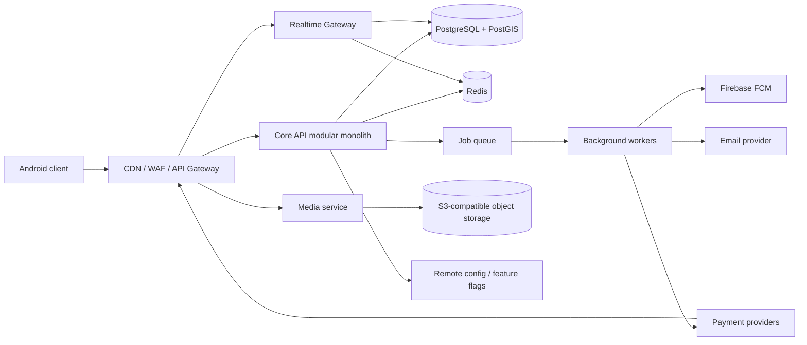
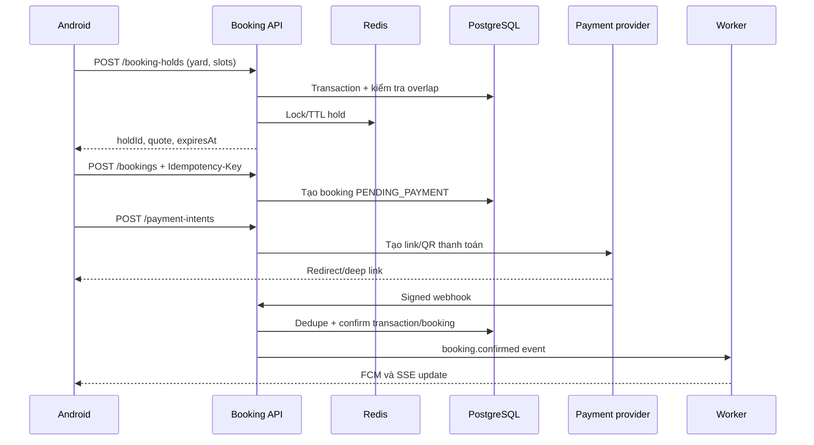

# Kiến trúc backend Anta

> Quyết định triển khai mới: chuyển backend sang **Python/FastAPI** theo từng module. Giữ PostgreSQL/PostGIS, Redis, R2 và API contract; FastAPI chạy song song trên cổng 8000 trong thời gian chuyển đổi. Tài liệu bên dưới vẫn mô tả ranh giới nghiệp vụ và bản NestJS tham chiếu, không có nghĩa là bản FastAPI đã đạt đầy đủ parity. Theo dõi tiến độ trong [python_backend/README.md](../python_backend/README.md).

> Phạm vi sản phẩm (08/10/2026): Anta không có sự kiện, khoá học và gói hội viên.

## 1. Kết luận kiến trúc

Không nên dựng backend này như một CRUD đơn giản. Anta là nền tảng đặt sân thể thao đa chi nhánh: booking thời gian thực, đặt định kỳ, dịch vụ bán thêm, voucher, nhiều cổng thanh toán, thông báo và chat.

Kiến trúc phù hợp cho giai đoạn đầu là:

- Một **modular monolith** làm nguồn dữ liệu chính cho identity, catalog, booking và sales.
- Một tiến trình **realtime gateway** riêng cho Socket.IO/chat và SSE trạng thái thanh toán.
- Một tiến trình **worker** riêng cho webhook, FCM, email, hết hạn giữ chỗ, đồng bộ media và các tác vụ nền.
- PostgreSQL + PostGIS là nguồn dữ liệu chuẩn; Redis dùng cho cache, distributed lock, idempotency và hàng đợi; object storage dùng cho ảnh, audio, hóa đơn và QR.
- Tất cả API public đi qua một gateway duy nhất. Các module có thể tách thành microservice sau khi có tải thật, không tách sớm.

Stack tham chiếu để triển khai nhanh: **NestJS/TypeScript + PostgreSQL 16/PostGIS + Redis + BullMQ + Socket.IO + S3-compatible storage + Firebase Admin SDK** (chỉ cho FCM). Có thể thay NestJS bằng Spring Boot mà không đổi ranh giới module hay contract trong tài liệu này.

## 2. Sơ đồ tổng thể



Nguyên tắc sở hữu dữ liệu: client không gọi trực tiếp database hoặc cổng thanh toán để quyết định trạng thái nghiệp vụ. Mọi thay đổi booking/payment phải đi qua Core API; webhook của payment provider là nguồn xác nhận cuối cùng.

## 3. Ranh giới module

| Module | Trách nhiệm chính |
|---|---|
| Identity | Đăng ký, login email/phone, OTP, social login, refresh/revoke token, device session, linked account, xóa tài khoản |
| User/Profile | Hồ sơ, thể chất, môn yêu thích, cấp độ, vị trí ưa thích, privacy và personalization |
| Catalog/Geo | Sport, shop, branch, yard, bảng giá, giờ mở cửa, dịch vụ, ảnh, rule, tìm kiếm PostGIS |
| Availability | Sinh slot, kiểm tra lịch bận, giữ chỗ có TTL, giá theo ngày/giờ, khóa cạnh tranh |
| Booking | One-time/recurring booking, participant, lifecycle, cancel, pass yard, review |
| Sales/Service | Request order, service order, add-on, order lifecycle và shop fulfillment |
| Voucher/Pricing | Điều kiện áp dụng, quota, rank, time range, yard type, quote và discount |
| Payment | Payment intent, provider adapter, transaction, QR, receipt, refund và webhook |
| Notification | FCM device, inbox, preference, branch mute/block và campaign |
| Chat | Conversation, member/role, message, attachment, presence, unread, moderation và E2E handshake |
| Content | Banner, tin tức, hướng dẫn, điều khoản và cấu hình |
| Audit/Analytics | Click/business event, audit trail, reconciliation và operational report |

Mỗi module có controller, application service, domain model và repository riêng. Không được truy cập bảng của module khác trực tiếp từ controller; giao tiếp nội bộ qua service interface hoặc domain event.

## 4. Mô hình dữ liệu cốt lõi

Các bảng nên chia schema theo module nhưng dùng chung một PostgreSQL trong giai đoạn đầu.

| Nhóm | Bảng chính |
|---|---|
| Identity | `users`, `user_identities`, `otp_challenges`, `refresh_sessions`, `devices`, `linked_accounts` |
| Catalog | `sports`, `shops`, `branches`, `yards`, `yard_sport_types`, `opening_hours`, `price_rules`, `services`, `branch_media`, `branch_rules` |
| Geo | `provinces`, `wards`, `branch_locations`, `user_favorite_locations`; cột vị trí dùng `geography(Point,4326)` |
| Booking | `booking_holds`, `bookings`, `booking_occurrences`, `booking_slots`, `booking_participants`, `booking_services`, `booking_status_history`, `reviews` |
| Commerce | `orders`, `order_items`, `service_requests`, `vouchers`, `voucher_conditions`, `voucher_redemptions` |
| Payment | `payment_intents`, `payment_transactions`, `payment_attempts`, `payment_receipts`, `refunds`, `provider_webhook_events` |
| Notification | `notifications`, `notification_preferences`, `campaigns`, `outbox_events` |
| Chat | `conversations`, `conversation_members`, `messages`, `message_attachments`, `pinned_messages`, `conversation_tags`, `chat_key_sessions` |

Quy ước bắt buộc:

- ID dùng UUID/ULID; tiền lưu integer minor unit và kèm currency, không dùng float.
- Thời gian lưu UTC, branch giữ IANA timezone; API trả ISO-8601 có offset.
- Bảng nghiệp vụ có `created_at`, `updated_at`, `version`; dữ liệu cần audit có `created_by` và status history.
- Soft delete chỉ dùng cho nội dung cần khôi phục. Booking/payment/audit không xóa vật lý.
- Mọi bảng đa tenant có `shop_id` hoặc `branch_id` và index tenant tương ứng.

## 5. Contract API cần triển khai

Gateway public dùng `/api/v1`; API mới không tương thích mới tăng `/api/v2`. Response thống nhất:

```json
{
  "data": {},
  "meta": { "requestId": "01...", "page": 1, "pageSize": 20 },
  "error": null
}
```

Nhóm endpoint tối thiểu:

### Identity và user

- `POST /api/v1/public/auth/login`
- `POST /api/v1/public/auth/social`
- `POST /api/v1/public/auth/otp/send`
- `POST /api/v1/public/auth/otp/verify`
- `POST /api/v1/public/auth/refresh`
- `POST /api/v1/auth/logout`
- `GET|PATCH /api/v1/users/me`
- `POST|DELETE /api/v1/users/me/devices/{deviceId}`
- `GET|POST|PATCH|DELETE /api/v1/users/me/linked-accounts`
- `DELETE /api/v1/users/me` với re-auth và thời gian chờ xóa.

### Catalog, map và availability

- `GET /api/v1/public/sports`
- `GET /api/v1/public/branches?lat=&lng=&radius=&sportId=&date=`
- `GET /api/v1/public/branches/{branchId}`
- `GET /api/v1/public/branches/{branchId}/services`
- `GET /api/v1/public/branches/{branchId}/availability?from=&to=&sportId=`
- `POST /api/v1/booking-holds` và `DELETE /api/v1/booking-holds/{holdId}`.

### Booking

- `POST /api/v1/bookings` với header `Idempotency-Key`.
- `GET /api/v1/users/me/bookings` và `GET /api/v1/bookings/{bookingId}`.
- `POST /api/v1/bookings/{bookingId}/cancel`.
- `POST|DELETE /api/v1/bookings/{bookingId}/participants`.
- `POST /api/v1/bookings/{bookingId}/services`.
- `POST /api/v1/bookings/{bookingId}/reviews`.

### Order, voucher và payment

- `POST /api/v1/orders`, `GET /api/v1/orders/{orderId}`, `POST /api/v1/orders/{orderId}/cancel`.
- `POST /api/v1/quotes` trả subtotal, discount, deposit, fee và expiry.
- `POST /api/v1/vouchers/validate`.
- `POST /api/v1/payment-intents`.
- `GET /api/v1/payment-intents/{paymentIntentId}`.
- `POST /api/v1/payment-intents/{id}/receipts`.
- `POST /api/v1/webhooks/payments/{provider}`; endpoint này xác thực chữ ký, dedupe event và không dùng auth của user.

### Notification, media và chat

- `POST /api/v1/devices/fcm-token`.
- `GET /api/v1/notifications`, `POST /api/v1/notifications/{id}/read`.
- `GET|PATCH /api/v1/notification-preferences`.
- `POST /api/v1/media/presign` và `POST /api/v1/media/complete`.
- Chat dùng `/api/v1/crypto/handshake`, `/api/v1/attachment/upload/init|chunk|complete`, `/conversation/*`, `/message/*`.

OpenAPI phải là nguồn contract chính. Android client được generate DTO/API interface từ OpenAPI; không sao chép model thủ công ở nhiều nơi.

## 6. Luồng booking và thanh toán



Các invariant bắt buộc:

- Database phải chặn overlap slot bằng transaction và unique/exclusion constraint; Redis lock chỉ là lớp tối ưu, không phải bảo đảm cuối.
- Hold có TTL ngắn, mặc định 5 phút. Worker giải phóng hold và booking chưa thanh toán quá hạn.
- `Idempotency-Key` áp dụng cho booking, order, payment intent, cancel và refund.
- Client redirect thành công không được tự chuyển booking sang paid; chỉ signed webhook hoặc đối soát provider được phép xác nhận.
- Booking định kỳ tạo occurrence riêng để hủy/đổi từng buổi và phát hiện xung đột chính xác.
- Mỗi thay đổi status phải đi qua state machine và ghi `booking_status_history`.

## 7. Realtime, notification và offline

- Socket.IO dùng cho chat, typing/presence, unread count và message acknowledgement. JWT cho handshake; reconnect dùng cursor/message sequence thay vì dựa vào thời gian thiết bị.
- SSE dùng cho trạng thái payment. Endpoint hỗ trợ `Last-Event-ID`, heartbeat, retry backoff và resume.
- FCM dùng cho trạng thái cần đến khi app background: booking confirmed/cancelled, payment, invitation và chat notification.
- Android cache dữ liệu đọc bằng Room/SQLite. Queue ghi offline chỉ dùng cho thao tác idempotent như mark-read/favorite; không queue ngầm booking hoặc payment.
- Outbox pattern bảo đảm transaction nghiệp vụ và event gửi worker không bị lệch trạng thái.

## 8. Bảo mật

- Access token 10-15 phút; refresh token xoay vòng, hash trong database và revoke theo device/session.
- OTP có TTL, giới hạn lần thử, cooldown, rate limit theo account/IP/device và chống user enumeration.
- RBAC theo `user`, `branch_staff`, `branch_owner`, `support`, `admin`; mọi truy vấn phải kiểm tra tenant ownership.
- Webhook payment xác minh signature/timestamp, lưu raw event hash để dedupe và chạy reconciliation định kỳ.
- Upload dùng presigned URL, allowlist MIME/size, quét malware và tách bucket public/private.
- Mã hóa PII và payment receipt khi lưu; secret nằm trong secret manager, không nằm trong APK hay Git.
- Chat key handshake và key rotation phải được threat-model riêng; không tự thiết kế mật mã mới.
- Rate limit gateway, validation schema, CORS/deep-link allowlist, audit log cho thao tác admin và account deletion.

## 9. Logging và observability

Android ghi log qua `Logger.kt`:

- `SCREEN_SHOW` cho mỗi màn.
- `DIALOG_SHOW` cho popup/dialog/bottom sheet.
- `CLICK` cho mọi vùng tương tác.
- `CURL`, `REQUEST`, `RESPONSE` cho mọi request backend.

Log curl/request/response chỉ bật ở debug hoặc môi trường test và phải che `Authorization`, cookie, refresh token, OTP, password, email/phone nhạy cảm và signed URL. Production chỉ log method, route template, status, latency, request ID và kích thước payload.

Backend dùng JSON structured log với `requestId`, `userId` đã hash, `tenantId`, `bookingId/orderId/paymentId`, latency và error code. Gateway nhận hoặc sinh `X-Request-Id` rồi truyền qua Core, realtime, worker và webhook. Metric tối thiểu: API latency/error rate, lock conflict, booking conversion, hold expiry, webhook delay/failure, queue lag, SSE/Socket connections và FCM failure.

Tracing dùng OpenTelemetry; dashboard/alert dùng Prometheus + Grafana, log dùng Loki/ELK, exception server dùng Sentry hoặc tương đương.

## 10. Cấu trúc source đề xuất

```text
backend/
├─ apps/
│  ├─ api/                 # REST gateway + modular monolith
│  ├─ realtime/            # Socket.IO + SSE
│  └─ worker/              # queue consumers, FCM, webhook reconciliation
├─ packages/
│  ├─ contracts/           # OpenAPI schemas, event schemas, error codes
│  ├─ auth/
│  ├─ observability/
│  └─ testkit/
├─ modules/
│  ├─ identity/
│  ├─ catalog/
│  ├─ booking/
│  ├─ commerce/
│  ├─ payment/
│  ├─ notification/
│  ├─ chat/
│  └─ content/
├─ migrations/
├─ infra/                  # Docker, Terraform/K8s manifests, dashboards
└─ docs/                   # ADR, OpenAPI, event catalogue, runbooks
```

Mỗi module có `domain`, `application`, `infrastructure`, `http` và test. Không tạo shared package chứa mọi thứ; chỉ chia sẻ contract, auth primitives và observability.

## 11. Môi trường và triển khai

- `local`: Docker Compose với PostgreSQL/PostGIS, Redis, MinIO và mock payment/FCM.
- `dev`, `staging`, `prod`: database, bucket, Firebase project, signing key và payment merchant tách biệt hoàn toàn.
- CI chạy lint, unit test, integration test bằng database thật, contract test, migration dry-run, SAST/dependency scan và build image bất biến.
- CD chạy migration backward-compatible trước, rolling/blue-green deploy sau; có health/readiness check và rollback image.
- Backup PostgreSQL PITR, versioning object storage, Redis không là nguồn dữ liệu chuẩn. Kiểm thử restore định kỳ.

## 12. Lộ trình thực hiện

### Phase 0 - Contract và nền tảng

1. Chốt state machine booking/order/payment và error code.
2. Dựng monorepo, CI, Docker Compose, migration, auth skeleton, request ID và log redaction.
3. Xuất OpenAPI, tạo Android networking layer và môi trường mock.

### Phase 1 - MVP

1. Auth/OTP/social login, profile và FCM device.
2. Sport/branch/yard/map/search/detail.
3. Availability, hold, booking một lần, booking history và cancel.
4. Quote, payment intent, một provider sandbox, webhook và FCM.
5. Terms/version/content từ backend.

### Phase 2 - Đủ nghiệp vụ

1. Booking định kỳ.
2. Voucher/rank/favorite.
3. Service order, receipt upload và các provider thanh toán còn lại.
4. SSE payment.

### Phase 3 - Realtime và vận hành đầy đủ

1. Chat Socket.IO, attachment pipeline, moderation, unread/pin/search và crypto handshake.
2. Admin/owner portal, reconciliation, reporting và audit export.
3. Load test booking contention, DR drill, fraud/rate-limit tuning và observability SLO.

## 13. Điều kiện nghiệm thu backend

- Hai client cạnh tranh cùng yard/slot không thể cùng được confirm.
- Retry cùng `Idempotency-Key` không tạo booking/payment/order thứ hai.
- Webhook trùng hoặc đến sai thứ tự vẫn cho một trạng thái cuối đúng.
- SSE/Socket reconnect không mất event/message và không gửi trùng ở UI.
- Log có correlation end-to-end nhưng không lộ token/OTP/password/PII.
- Search theo bán kính dùng PostGIS và có index plan được kiểm tra.
- Migration có rollback/forward strategy; restore backup được kiểm chứng.
- Client log đủ screen/dialog/click/network.

Nếu sau này Settings có Feedback, app mở email tới `support@your-domain.com`; không cần tạo feedback API trừ khi sản phẩm bổ sung quản lý ticket trong admin portal.
